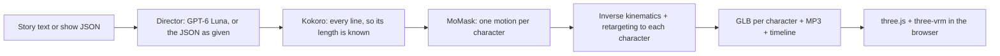

# TinyStage: MoMask as a service

ITCS 6166 (Computer Communication and Networks), Topic 2: Generative AI as a Service. Team 2:

- **Pablo Garces**: server (model, hosting, network measurements).
- **Ramisha Mahiyat**: client (Three.js character, story player).

**Try it online:** https://pgarces-momask-team2.hf.space/tinystage/

Streaming a short cartoon costs megabytes; the story behind it is one sentence. TinyStage sends the story instead of the video. You type a short story, and the server plans a show, generates every character's motion with [MoMask](https://github.com/EricGuo5513/momask-codes), a text-to-3D-motion model, and every line with [Kokoro](https://huggingface.co/hexgrad/Kokoro-82M), a text-to-speech model. It returns animation files, one audio track and a timeline, and the browser draws the 3D show itself with three.js. No video is sent: for our three example shows, 342–656 KB reach the browser, against 6.0–9.9 MB for the same shows as 720p video (see [Reproduce our results](#reproduce-our-results)).

This README is a guide to running the whole thing yourself: the MoMask model, the voices, the service and the TinyStage page.

## Run it yourself

Everything runs on the **CPU**; no GPU is needed. You do not retrain MoMask: the pretrained checkpoints are downloaded on the first start. An OpenAI key is **optional**. It is only used to turn free text into a show; the example shows are already written as JSON, so they skip it and still run MoMask, Kokoro and the inverse kinematics on your machine.

**You need:** Python 3.12, `ffmpeg`, and an internet connection for the first start (PyTorch, the MoMask checkpoints and the ~340 MB Kokoro voice model are downloaded). Tested on macOS (Apple silicon, CPU only).

### 1. Get the code

```bash
git clone https://github.com/PabloG55/MoMask-Team2.git
cd MoMask-Team2
```

### 2. Install

```bash
# ffmpeg, if you don't have it
brew install ffmpeg                                   # macOS
sudo apt-get update && sudo apt-get install -y ffmpeg  # Ubuntu / Debian

python3.12 -m venv .venv
source .venv/bin/activate
python -m pip install --upgrade pip
python -m pip install -r requirements.txt 'gradio==6.30.0' pytest
```

Gradio is installed separately because `requirements.txt` does not list it: on Hugging Face, the Space installs the version in this file's header (`sdk_version: 6.30.0`).

### 3. Optional: an OpenAI key for free-text stories

```bash
cp .env.example .env
```

Put your key in `.env` as `OPENAI_API_KEY=...`. The director model is `gpt-6-luna` unless `OPENAI_MODEL` says otherwise. `.env` is git-ignored; on a Space, the key is a secret named `OPENAI_API_KEY`. Skip this step to run only the JSON example shows.

### 4. Start the service

```bash
python app.py
```

The first start downloads the MoMask checkpoints from [`pgarces/momask-checkpoints`](https://huggingface.co/pgarces/momask-checkpoints) into `momask/checkpoints/` and the Kokoro voice files into `app/checkpoints/kokoro/` (or the folder in `KOKORO_DIR`). Later starts reuse them. Then open:

- http://127.0.0.1:7860/ : the Gradio page, with **Story**, **Show** and **One action** tabs. The Show tab is already filled in with an example show: click **Make the show**.
- http://127.0.0.1:7860/tinystage/?space=http://127.0.0.1:7860 : TinyStage on your own server. Keep the `?space=` part: without it, the page sends stories to our hosted Space instead of your `app.py`.

### 5. Call it from code

With the server running, in a second terminal (same `.venv`, from the repository root):

```python
import json
from gradio_client import Client

with open("app/client/story/examples.json", encoding="utf-8") as f:
    example = json.load(f)[0]["show"]

client = Client("http://127.0.0.1:7860/")   # or "pgarces/MoMask-Team2" for the hosted Space
motions, voices, timeline = client.predict(json.dumps(example), 42, api_name="/show")
print(len(motions), "motion files,", voices, timeline["duration"], "s")
```

On a Mac CPU this example takes about 15 s and returns 2 motion files, the voices and a 31.6 s show. With an OpenAI key in `.env`, pass a sentence instead of `json.dumps(example)`.

### 6. Run the tests

```bash
python -m pytest app/tests -q
```

You should see `53 passed`. They cover the server, story mode, show mode (the director's checks, the camera plan, the voices, the sets) and the timing, arms and head fixes, all without loading MoMask, so they need no model download and take a few seconds.

**Saved shows.** `app/client/story/demo/` holds the three example shows already made, so the page can also play them with no server at all: run `python3 -m http.server 8831 --directory app/client/story` and open http://127.0.0.1:8831/index.html?demo=1, then pick one of the three ideas.

## Reproduce our results

### Milestone 2: the authors' MoMask, run as published

[`notebooks/Team2_MoMask_Milestone2.ipynb`](notebooks/Team2_MoMask_Milestone2.ipynb) is the Google Colab notebook we used. It clones the authors' repository at commit `94a6636`, applies the three compatibility fixes listed under [What we changed from upstream](#what-we-changed-from-upstream) (NumPy `matrix_multiply`, `np.float`, Matplotlib), downloads the authors' pretrained checkpoints with their `prepare/download_models.sh`, and generates the two clips in our report: "A person walks forward." and "A person waving his hand.", each 100 frames, seed 42, 10 masked-generation iterations. No training is done.

1. Open it in Colab: https://colab.research.google.com/github/PabloG55/MoMask-Team2/blob/main/notebooks/Team2_MoMask_Milestone2.ipynb
2. **Runtime → Change runtime type → T4 GPU.**
3. Run the cells in order, down to the version check (`git rev-parse HEAD`). Each clip appears as an MP4 under its cell; our own outputs are saved in the notebook, so you can compare them before running anything. The next cell zips the outputs for download.
4. Skip the last two cells. They copied the same checkpoints to our Hugging Face repo [`pgarces/momask-checkpoints`](https://huggingface.co/pgarces/momask-checkpoints), which is where `app.py` downloads them from, and they need our write token.

We ran it with Python 3.13.15, PyTorch 2.11.0 (CUDA 13.0) and NumPy 2.1.3 on a Tesla T4. The FID and R-precision numbers we quote are from the MoMask paper; we did not re-run the evaluation, which needs the HumanML3D dataset.

### Milestone 3: TinyStage's time and size

Every `/show` response carries its own measurements in `timeline["stats"]`: the server's seconds per stage (`plan`, `voices`, `motion`, `ik_retarget`, `audio`, `total`) and the bytes of each part (story text, motion `.glb` raw and gzipped, the same motion as BVH, the voices `.mp3`, the timeline). With `app.py` running (step 4 above), this runs the three example shows and compares what is sent with the same show as video:

```python
import json
from gradio_client import Client

client = Client("http://127.0.0.1:7860/")   # or "pgarces/MoMask-Team2" to measure the hosted Space
with open("app/client/story/examples.json", encoding="utf-8") as f:
    examples = json.load(f)

for example in examples:
    motions, voices, timeline = client.predict(json.dumps(example["show"]), 42, api_name="/show")
    stats = timeline["stats"]
    sizes = stats["bytes"]
    sent = sizes["motion_glb"] + sizes["voices_mp3"] + sizes["timeline_json"]
    video = timeline["duration"] * 2.5e6 / 8   # the same show as 720p video at 2.5 Mbit/s
    print(example["show"]["title"], f'({timeline["duration"]:.1f} s show)')
    print("  server seconds:", stats["seconds"])
    print(f"  sent {sent / 1000:.0f} KB vs {video / 1e6:.1f} MB as 720p video ({video / sent:.0f}x less)")
```

On a MacBook (Apple silicon, CPU only) it printed:

| Show | Length | Server time (voices / MoMask / IK + retarget) | Sent to the browser | Same show as 720p video |
|---|---|---|---|---|
| Dino's big jump | 31.6 s | 13.3 s (2.9 / 5.2 / 5.1) | 546 KB | 9.9 MB (18× more) |
| A walk on the moon | 30.0 s | 16.9 s (2.3 / 7.7 / 6.8) | 656 KB | 9.4 MB (14× more) |
| El baile de Froggy | 19.2 s | 6.9 s (1.6 / 3.4 / 1.9) | 342 KB | 6.0 MB (18× more) |

The video size is an estimate (the show's length at 2.5 Mbit/s, a common 720p bitrate); Dino's show rendered as a real H.264 file was 5.5 MB. `plan` is 0 because a JSON show skips the language model; a free-text story adds the director's call, about 5 s. Times vary from run to run and machine to machine. On the hosted Space's shared CPU, the Froggy show took 30.6 s (voices 14.3 s, MoMask 10.8 s, IK and retarget 3.9 s). The saved shows in `app/client/story/demo/*/timeline.json` carry the stats from when they were made.

## API

| Endpoint | Inputs | Returns | Format |
|---|---|---|---|
| `/generate` | `text`, `length_frames`, `seed` | BVH skeleton, MP4 stick-figure preview, stats JSON | `app/server/api.py` |
| `/story` | `story`, `seed`, `smooth` | one Xbot animation-only `.glb`, narration `.mp3`, timeline | [`app/docs/STORY-API.md`](app/docs/STORY-API.md) |
| `/show` | `story`, `seed` | one animation-only `.glb` per character, voices `.mp3`, timeline | [`app/docs/SHOW-API.md`](app/docs/SHOW-API.md) |

`story` is free text (needs the OpenAI key) or a show written as JSON (no LLM). The `.glb` files hold only the animation: the browser loads each character's `.vrm` and plays the animation on its skeleton. The `/show` timeline carries the subtitles, the camera plan and a mouth track per character.

```python
bvh_path, mp4, stats = client.predict("a person walks forward", 100, 42, api_name="/generate")
# stats: {"frames": 100, "generation_seconds": 2.62, "bvh_bytes": 70515, "mp4_bytes": 43364}
```

`generation_seconds` measures the model only (the example is from a Mac CPU). From JavaScript, the page uses `@gradio/client`:

```js
import { Client } from '@gradio/client';

const app = await Client.connect('pgarces/MoMask-Team2');
const { data } = await app.predict('/show', {
  story: 'An astronaut meets a robot and a friendly alien on the moon.',
  seed: 42,
});
const [motions, voices, timeline] = data;
```

## How `/show` works



1. **Director** (`app/story/director.py`): picks up to 3 of 10 characters, a set, a light and up to 6 steps, each with one action, a camera shot and the lines around it. The output is checked before it is used.
2. **Voices** (`app/story/show.py`, `app/story/narration.py`): Kokoro speaks every line first, in each character's own voice and pitch, so the line lengths set the timing.
3. **Motion** (`app/story/beats.py`, `app/story/motion.py`): the characters take turns, and each one gets a motion for every segment: its action on its turn, standing or talking otherwise.
4. **Body** (`app/story/ik.py`, `app/story/retarget.py`, `app/story/collide.py`): inverse kinematics turns MoMask's 22 joint positions into bone rotations, which are mapped onto each character's skeleton, with the arms kept out of the character's own head and body.
5. **Response** (`app/story/show.py`, `app/story/gltf.py`): one animation-only `.glb` per character, one `.mp3`, and a timeline with the subtitles, the camera plan and the mouth tracks.

The page is `app/client/story/` (`main.js` for the steps, `player.js` for the 3D show), a static page with no build step. Story mode (`/story`) is the earlier, single-character version: one Xbot, a narrator, and MoMask's own temporal editing around each change of action, which cuts the jump at the first change from 12.9 to 1.3 cm per frame.

## Phone app (optional)

`app/expo-mobile/` is an Expo (React Native) app that shows the TinyStage page in a WebView. It needs Node 22.13 or newer and [Expo Go](https://expo.dev/go) on the phone:

```bash
cd app/expo-mobile
npm ci
npx expo start --clear
```

Scan the QR code with Expo Go. It loads the hosted page by default (set `EXPO_PUBLIC_STORY_URL` to use another), so it needs no local server. See [`app/expo-mobile/README.md`](app/expo-mobile/README.md).

## Deploying to a Space

The Space needs `app.py`, `momask/`, `app/server/`, `app/story/` (with `app/story/characters/*.json`), `app/client/docs/assets/character/Xbot.glb`, which the Story tab shows, and all of `app/client/story/`, which `app.py` serves as the TinyStage page at `/tinystage/`. Before uploading, add `*.vrm`, `*.glb` and `*.mp3` to the upload copy's `.gitattributes` as LFS, because Hugging Face wants binary files in LFS/Xet and the Space build otherwise checks out the pointer text instead of the file. Free text needs the Space secret `OPENAI_API_KEY`. Keep the YAML header at the top of this file: it is the Space's configuration.

**Assets.** Every character and set model is CC0: 10 avatars from 100Avatars by Polygonal Mind (`app/client/story/characters/*.vrm`, with their skeletons in `app/story/characters/*.json`), and models from Kenney's Nature, Furniture, Pirate and Space kits (https://kenney.nl), built by `app/tools/build_sets.py` and credited per model in `app/client/story/sets/CREDITS.md`.

## What we changed from upstream

This repository started as a copy of [EricGuo5513/momask-codes](https://github.com/EricGuo5513/momask-codes) at commit `94a6636`.

- `momask/`: their code. The model, training and inference code are unchanged, and their scripts still run from inside it, as in their README (`cd momask && python gen_t2m.py --gpu_id -1 --text_prompt "a person walks forward"`).
- `app/`: ours. `app/server/` is the Gradio service (`models.py` loads MoMask, `api.py` is what `/generate`, `/story` and `/show` do, `ui.py` is the page); `app/story/` is story and show mode; `app/client/docs/` is the Xbot client and `app/client/story/` the show player; `app/tests/` covers all of it without loading MoMask; `app/tools/` rebuilds the skeletons and sets; `app/docs/` has the two API formats.
- `app.py`: starts the service. It puts `app/` and `momask/` on the import path, and the server enters `momask/` only while loading the models, because MoMask opens `./checkpoints` and `./visualization/data` from its own folder.
- `requirements.txt`: rewritten for torch 2.11 / numpy 2.1.3. The original pins torch 1.12, which ZeroGPU does not accept. Story mode adds `openai`, `python-dotenv` and `kokoro-onnx`.
- `packages.txt`: `ffmpeg`, for the MP4 preview

And made compatibility fixes so the original code runs on current libraries:

- `momask/visualization/Animation.py`, `momask/visualization/Quaternions.py`: `numpy.core.umath_tests.matrix_multiply` → `np.matmul` (removed in NumPy 2)
- `momask/visualization/remove_fs.py`, `momask/utils/motion_process.py`, `momask/common/quaternion.py`: `np.float` → `float` (alias removed from NumPy)
- `momask/utils/plot_script.py`: `Axes3D(fig)` → `fig.add_subplot(111, projection="3d")`, and frame clearing with `artist.remove()` (both required by newer Matplotlib)

Training, evaluation and dataset scripts from upstream are still in `momask/` but untested with these dependencies. For those, follow the [upstream README](https://github.com/EricGuo5513/momask-codes#readme).

## Troubleshooting

| Symptom | Fix |
|---|---|
| `ModuleNotFoundError: gradio` | `python -m pip install 'gradio==6.30.0'` in the same `.venv`. |
| `ffmpeg` not found | Install it (step 2) and check `ffmpeg -version`. |
| The first start is slow | It is downloading the MoMask checkpoints and the Kokoro files; later starts reuse them. |
| A free-text story fails but a JSON show works | There is no `OPENAI_API_KEY` in `.env`, or the key cannot use the configured model. |
| The local TinyStage page works but your server shows no request | Add `?space=http://127.0.0.1:7860` to the page URL; otherwise it uses the hosted Space. |
| Port 7860 is already in use | Another `app.py` is running: reuse it, or find and stop it (`lsof -nP -iTCP:7860 -sTCP:LISTEN`). |
| No sound on a phone | Browsers need a tap before they play sound: press Play and unmute the device. |

## Credit

MoMask is the work of Chuan Guo, Yuxuan Mu, Muhammad Gohar Javed, Sen Wang and Li Cheng (University of Alberta):

> *MoMask: Generative Masked Modeling of 3D Human Motions.* CVPR 2024. [Paper](https://arxiv.org/abs/2312.00063) · [Project page](https://ericguo5513.github.io/momask/) · [Code](https://github.com/EricGuo5513/momask-codes)

```bibtex
@inproceedings{guo2024momask,
  title={Momask: Generative masked modeling of 3d human motions},
  author={Guo, Chuan and Mu, Yuxuan and Javed, Muhammad Gohar and Wang, Sen and Cheng, Li},
  booktitle={Proceedings of the IEEE/CVF Conference on Computer Vision and Pattern Recognition},
  pages={1900--1910},
  year={2024}
}
```

Also used: [Kokoro-82M](https://huggingface.co/hexgrad/Kokoro-82M) for the voices, [three.js](https://threejs.org/) and [three-vrm](https://github.com/pixiv/three-vrm) for playback, and [Gradio](https://www.gradio.app/) on [Hugging Face Spaces](https://huggingface.co/spaces) for serving.

The original code is MIT-licensed; its copyright notice is kept in [`LICENSE`](LICENSE).
