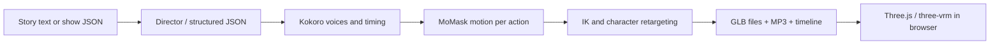

# TinyStage — turn a story into a 3D animated show

**MoMask as a Service · ITCS 6166 · Team 2**

**[Try TinyStage](https://pgarces-momask-team2.hf.space/tinystage/)** · **[Hugging Face Space / API](https://huggingface.co/spaces/pgarces/MoMask-Team2)** · **[MoMask paper](https://arxiv.org/abs/2312.00063)**

TinyStage is a text-to-3D-story application built on [MoMask](https://github.com/EricGuo5513/momask-codes). Type a short story, wait while the AI plans and generates it, and watch a short show with animated characters, voices, subtitles and camera cuts. **The browser renders the 3D scene with Three.js; the server sends animation files, audio and timing data—not an encoded video.**

The source code includes **three ready-to-play shows**, so you can reproduce the user interface and 3D playback **without a GPU, an OpenAI key, or a local AI server**. Running the entire generation pipeline on your own machine is a separate, more demanding setup described below.

> **Start here:** If you're new to the repository, complete **Section 2 (Option A: play a saved show)**. Only continue to **Section 4 (Option C: full local backend)** if you need to reproduce AI inference.

## What is included?

- **Story writer:** one text box, three suggested stories and a **Make my show** button.
- **Curtain loading screen:** changing messages and an elapsed-time counter while `/show` runs.
- **Interactive 3D player:** characters, five possible sets, audio, subtitles, camera cuts, play/pause, seeking and replay.
- **Three bundled shows:** Dino's big jump, A walk on the moon and El baile de Froggy (Spanish).
- **Generation service:** Gradio endpoints `/generate`, `/story` and `/show`.
- **Optional mobile client:** an Expo/React Native development project that loads the existing Three.js viewer inside a WebView.
- **Tests and documentation:** unit tests plus detailed API response schemas.

### Three ways to reproduce the project

| Goal | What you run | AI inference | OpenAI key |
|---|---|---|---|
| **A. Play the bundled shows** | Python static web server + browser | None | No |
| **B. Create stories with the hosted Space** | Same browser page, connected to the public Space | On hosted service | No client-side key; free text depends on the hosted service's configuration |
| **C. Reproduce the backend yourself** | Python 3.12, Gradio, MoMask and Kokoro | Your computer (CPU) | Only for natural-language story planning; structured JSON bypasses the language model |

---

## Requirements

### Option A / B (web client)

- Python 3 (for the built-in local HTTP server); **no `pip install`, npm or build step**.
- A modern Chrome, Edge, Firefox or Safari browser with **WebGL**.
- Internet access to load Three.js, three-vrm and fonts from CDNs, **even when the saved show files are local**. Once loaded, the bundled demo itself does not call the AI service.

### Option C (full local backend)

- **Python 3.12** (matches the bundled Hugging Face Space configuration; the repository's original setup was tested on macOS/Apple silicon, CPU only).
- `ffmpeg` executable on your system `PATH`.
- Internet access and disk space for the **MoMask checkpoints** and **Kokoro voice model** (the latter is approximately 353 MB). These are downloaded on first startup and are **not included** in the ZIP/repository.
- Sufficient RAM and free disk space for PyTorch and models. CPU inference works but can be slow; performance varies by computer.
- Optionally, an OpenAI API key with access to the configured director model for **free-text** `/story` and `/show`.

**Platform note:** The documented backend setup targets macOS/Linux using a POSIX shell. On Windows, use WSL2/Linux for the closest environment; a native Windows backend installation is not verified here. The static web client works on Windows, macOS and Linux.

---

## 1. Get the source code

**Clone from GitHub:**

```bash
git clone https://github.com/PabloG55/MoMask-Team2.git
cd MoMask-Team2
```

Or download the repository ZIP from GitHub, extract it, and open a terminal **inside the extracted root folder** (the folder containing `app.py`, `requirements.txt`, `app/` and `momask/`). The supplied archive uses the directory name `MoMask-Team2-main`.

If you cloned a repository checkout with Git LFS pointer files, install [Git LFS](https://git-lfs.com/) and run `git lfs pull`. For the web demos, make sure `app/client/story/characters/`, `sets/` and `demo/` contain the actual binary assets, not small text pointer files.

## 2. Option A — Play a saved show (no model download or API key)

From the **repository root**:

```bash
python3 -m http.server 8831 --directory app/client/story
```

On Windows, `py -m http.server 8831 --directory app/client/story` is an alternative. Leave that terminal running.

Open this URL **exactly**, including `index.html`:

**http://127.0.0.1:8831/index.html?demo=1**

1. Tap/click one of the three suggested stories (dinosaur, astronaut or frog).
2. Click **Make my show**.
3. The curtain appears, then the bundled 3D show loads and plays.
4. Try **Pause/Play**, the timeline slider, **Watch it again**, and **Make another story**. If the browser blocks sound autoplay, press **Play**.

**Expected result:** a real-time WebGL scene with characters and subtitles and a synchronized MP3. No call to `/show` is made in this mode. `?demo=1` only supports the three included examples; arbitrary text cannot be generated without a backend.

Saved-show files are located at:

```text
app/client/story/demo/
├── dino-s-big-jump/       # DinoKid.glb, Teddy.glb, voices.mp3, timeline.json
├── a-walk-on-the-moon/    # 3 character GLBs, voices.mp3, timeline.json
└── el-baile-de-froggy/    # 2 character GLBs, voices.mp3, timeline.json
```

A direct saved-show test is also available:

```text
http://127.0.0.1:8831/index.html?show=demo/dino-s-big-jump
```

To stop the server, press `Ctrl+C` in its terminal.

## 3. Option B — Generate a show using the hosted Space

You do **not** have to install PyTorch or host your own AI service to try the team's existing deployment.

**Fastest:** open **https://pgarces-momask-team2.hf.space/tinystage/**.

**Using the local copy of the client:** leave the static server from Option A running, then open:

**http://127.0.0.1:8831/index.html**

1. Type a short ordinary-language story or choose an example.
2. Click **Make my show**.
3. The client imports `@gradio/client` and connects to the Space `pgarces/MoMask-Team2`.
4. It calls `/show` with `{ story, seed: 42 }`.
5. The service returns character `.glb` motion files, one `.mp3` voice track and a timeline; the viewer renders them.

Generation commonly takes **30–60 seconds or longer**, especially if the Space needs to wake up. If the hosted Space is unavailable or does not have its director API key configured, *arbitrary* free-text stories may fail. For one of the three sample ideas, the frontend tries a structured show without the language model and, if needed, falls back to the included prerecorded show **with a visible explanatory note**.

To target a different Gradio backend during development, the current browser client supports an optional URL query parameter:

```text
http://127.0.0.1:8831/index.html?space=http://127.0.0.1:7860
```

This points the **browser client** at your local `/show` service (Option C). Do not put secret API keys in client-side JavaScript or query parameters.

---

## 4. Option C — Run the full AI backend locally

This reproduces the **generation pipeline**, not just the prerecorded demos. It downloads pretrained weights; **you do not need to train MoMask from scratch**.

### 4.1 Install Python 3.12 and FFmpeg

Confirm Python 3.12 is available:

```bash
python3.12 --version
```

Install FFmpeg with your system package manager if necessary:

```bash
# macOS with Homebrew
brew install ffmpeg

# Ubuntu / Debian
sudo apt-get update && sudo apt-get install -y ffmpeg
```

Then check:

```bash
ffmpeg -version
```

### 4.2 Create an isolated environment and install dependencies

From the **repository root**:

```bash
python3.12 -m venv .venv
source .venv/bin/activate
python -m pip install --upgrade pip
python -m pip install -r requirements.txt 'gradio==6.30.0' pytest
```

**Why is Gradio installed separately?** `app.py` and `app/server/ui.py` import Gradio, but the `requirements.txt` in this ZIP does **not** list it. Version `6.30.0` comes from this repository's Hugging Face Space metadata. The requirements also install PyTorch, CLIP, NumPy, Kokoro ONNX and the other server dependencies.

If the pinned `torch==2.11.0` wheel is unavailable for your exact Python/OS/CPU combination, dependency installation will stop. Choose a compatible supported environment rather than silently changing library versions and assuming identical results.

### 4.3 Optional: enable natural-language planning

**Not needed** for `/generate`, the three bundled shows, or a hand-written JSON show sent to `/show`.

To let the backend *plan a show from ordinary text*, create a local `.env` file:

```bash
cp .env.example .env
```

Edit `.env`:

```dotenv
OPENAI_API_KEY=your_actual_key_here
OPENAI_MODEL=gpt-6-luna
```

The model name above is what this code defaults to; your API account must have access to the configured model. Keep `.env` private—it is already ignored by `.gitignore`. On a Hugging Face Space, configure `OPENAI_API_KEY` as a **Space secret**, never as a public variable in the frontend.

### 4.4 Start the service

```bash
python app.py
```

The first startup calls `server.api.start()` and downloads/loads:

- MoMask pretrained checkpoints from **[`pgarces/momask-checkpoints`](https://huggingface.co/pgarces/momask-checkpoints)** into `momask/checkpoints/`.
- Kokoro ONNX voice files from the release URLs in `app/story/narration.py` into `app/checkpoints/kokoro/` (or the path specified by `KOKORO_DIR`).

Wait for startup to finish, then open **http://127.0.0.1:7860/** (the normal Gradio default port). The Gradio UI contains **One action**, **Story** and **Show** tabs. The server also mounts the TinyStage web client at **http://127.0.0.1:7860/tinystage/**.

### 4.5 Prove local inference works without an OpenAI key

The **Show** tab is prefilled with a structured example from `app/client/story/examples.json`. Click **Make the show**. Since that input is already JSON, it skips the OpenAI director but **still runs Kokoro, MoMask, inverse kinematics and export** on your local CPU.

For a reproducible Python API smoke test, open a **second terminal**, activate the same `.venv`, and run this from the repository root:

```bash
python - <<'PY'
import json
from gradio_client import Client

with open('app/client/story/examples.json', encoding='utf-8') as file:
    example = json.load(file)[0]['show']

client = Client('http://127.0.0.1:7860')
motions, voices, timeline = client.predict(
    story=json.dumps(example), seed=42, api_name='/show'
)
print('Character motion files:', motions)
print('Voice track:', voices)
print('Show duration:', timeline['duration'], 'seconds')
PY
```

For free-text inference, add an `OPENAI_API_KEY` as above and replace the structured `story` argument with a short sentence.

---

## 5. API reference

The Gradio backend exposes **three** public endpoints. The output data and files can be inspected from the Gradio interface and from the reference documents linked below.

| Endpoint | Inputs | Returns | Full reference |
|---|---|---|---|
| `/generate` | `text`, `length_frames`, `seed` | BVH skeleton, MP4 preview, stats JSON | `app/server/api.py` |
| `/story` | `story`, `seed`, `smooth` | One Xbot animation-only GLB, narration MP3, timeline JSON | [`app/docs/STORY-API.md`](app/docs/STORY-API.md) |
| `/show` | `story`, `seed` | One animation-only GLB per character, voices MP3, timeline JSON | [`app/docs/SHOW-API.md`](app/docs/SHOW-API.md) |

The `.glb` files from `/show` have **no character mesh**. The browser loads the character's static `.vrm` file and applies the returned animation to its skeleton. The timeline supplies subtitles, camera shots and mouth movement. This distinction matters when reusing the output in another player.

**JavaScript example (hosted Space):**

```js
import { Client } from '@gradio/client';

const app = await Client.connect('pgarces/MoMask-Team2');
const { data } = await app.predict('/show', {
  story: 'An astronaut meets a robot and a friendly alien on the moon.',
  seed: 42,
});

const [motions, voices, timeline] = data;
console.log(motions, voices, timeline);
```

**Python example (single motion):**

```python
from gradio_client import Client

client = Client('http://127.0.0.1:7860')
bvh, mp4, stats = client.predict(
    text='a person walks forward', length_frames=100, seed=42,
    api_name='/generate'
)
print(bvh, mp4, stats)
```

**Server-side pipeline for `/show`:**



The director (`app/story/director.py`) selects characters, locations, lighting, actions, dialogue and camera shots. The motion code generates and joins action clips, while inverse kinematics converts joint positions to rotations for the cartoon rigs. The player synchronizes motion to audio time, so the result is **rendered interactively rather than streamed as a movie**.

---

## 6. Optional: run the Expo/React Native mobile prototype

The ZIP **does include** `app/expo-mobile/`, including a `package.json` and `package-lock.json`. It is a **hybrid development app**, not a fully native 3D renderer: native React Native story/loading screens host the existing Three.js viewer in `react-native-webview`.

With a suitable Node.js installation (**the included Expo version requires at least Node 22.13.0**) and [Expo Go](https://expo.dev/go) on a phone:

```bash
cd app/expo-mobile
npm ci
npx expo start --clear
```

Scan the QR code in Expo Go. **By default, this version loads the hosted TinyStage page from** `https://pgarces-momask-team2.hf.space/tinystage/`, so you do **not** need a Mac-hosted Python server or `.env.local` to try that hosted version.

For a development-only **local** story page, copy `.env.example` to `.env.local` and set `EXPO_PUBLIC_STORY_URL` to `http://YOUR_MAC_WIFI_IP:8831/index.html`; keep the static server running with `--bind 0.0.0.0`. A phone's `localhost` points at the phone, **not your computer**. Restart Expo after changing environment variables.

See [`app/expo-mobile/README.md`](app/expo-mobile/README.md) for mobile test steps and limitations. This prototype is **not** a verified App Store/Play Store release, and real-device audio/WebView behavior should be tested separately.

For phone access with **no Expo**, open the hosted TinyStage site directly in the device's Chrome or Safari browser. The web client is responsive, subject to the device supporting WebGL and audio playback.

---

## 7. Run the automated tests

With the **backend environment** installed and activated, from the repository root:

```bash
python -m pytest app/tests -q
```

The `app/tests/` directory tests API wiring, story/show cleaning, time planning, retargeting-related logic and other components using mocks; it is designed not to download the MoMask weights. **Passing tests does not replace a live full-model test or a real-browser/phone playback check.**

Useful manual acceptance checks:

1. Saved dinosaur, astronaut and frog shows load from `?demo=1` with animated models and sound.
2. The show can pause, seek, replay and return to the story form.
3. A real `/show` request returns motion(s), voices and a timeline (when the service is available).
4. The same page works at a phone-sized viewport; real-phone functionality should be verified on a phone, not only in Chrome DevTools.

## 8. Project layout

```text
MoMask-Team2/
├── app.py                    # Gradio app; mounts /tinystage/
├── requirements.txt          # Backend Python dependencies (Gradio installed separately)
├── packages.txt              # ffmpeg for the Hugging Face Space environment
├── .env.example              # Optional server-side OpenAI configuration
├── app/
│   ├── server/               # /generate, /story, /show API and model loading
│   ├── story/                # Planning, TTS, MoMask orchestration, IK, retargeting
│   ├── client/
│   │   ├── story/            # TinyStage browser UI (index.html, main.js, player.js)
│   │   │   ├── characters/   # 10 .vrm avatars
│   │   │   ├── sets/         # stage, park, room, beach, space
│   │   │   └── demo/         # Three bundled shows: GLB + MP3 + timeline
│   │   └── docs/             # Older Xbot animation client and assets
│   ├── expo-mobile/          # Optional React Native / Expo prototype
│   ├── docs/                 # SHOW-API.md and STORY-API.md
│   ├── tests/                # Automated tests
│   └── tools/                # Skeleton / asset preparation utilities
└── momask/                   # Upstream MoMask implementation + compatibility fixes
```

## 9. Troubleshooting

| Symptom | Explanation / fix |
|---|---|
| **404 at `localhost`** | Start the static server **from the repository root** with `--directory app/client/story`. Type `http://127.0.0.1:8831/index.html` directly. Don't include an extra `/docs/`, `**` or copied tracking characters in the path. |
| **`Address already in use` on port 8831** | An old server is running. Reuse it if it serves the right directory, or stop that process / choose another port (and update your URL). On macOS: `lsof -nP -iTCP:8831 -sTCP:LISTEN`. |
| **Blank 3D canvas or missing objects** | Check the browser console, WebGL support, CDN access, and that `characters/`, `sets/`, `demo/` contain real binary files. Serve over HTTP; don't double-click `index.html` as a `file://` page. |
| **Demo button says to select an idea** | `?demo=1` supports only the three built-in example sentences. Click one of the example cards instead of typing a different story. |
| **Audio is silent on a phone** | Browsers often need an explicit user gesture before playing sound. Press **Play** and unmute the device. |
| **Free-text show fails but saved show plays** | Check hosted Space availability, server logs and `OPENAI_API_KEY`/model access. JSON-based shows skip the LLM; saved shows skip the generation service altogether. |
| **First backend startup is slow** | It downloads model checkpoints and Kokoro files, then loads them in memory. Future launches can reuse the local downloads. |
| **`ModuleNotFoundError: gradio`** | Install the version in the repo metadata: `python -m pip install 'gradio==6.30.0'`. |
| **`ffmpeg` not found** | Install FFmpeg as a system executable, then confirm `ffmpeg -version`. |
| **Expo `package.json` missing** | You are not in `app/expo-mobile/` or your copy of the project is incomplete. The ZIP supplied for this README includes the package file. |
| **Expo says Node is too old** | Run `node -v` **in the same terminal** where you start Expo. Use Node >=22.13.0; different terminals can select different installations. |
| **Android/iPhone cannot reach a local player** | Use the computer's LAN IP, the same Wi-Fi, and a server listening on `0.0.0.0`; do not use `localhost` from the phone. The current Expo app defaults to the hosted Space and normally doesn't need a local player URL. |

## 10. Reproducibility notes and limitations

- **Pretrained, not retrained:** We use the authors' trained MoMask checkpoints. The upstream training/evaluation scripts are included under `momask/`, but reproducing model training is **not** part of this application's quick start.
- **Model behavior:** MoMask predicts **22-joint human motions at 20 fps**, then the application retargets them to cartoon VRM skeletons. Complex props, face details, multi-person interactions, and some limb collisions remain limitations.
- **Determinism:** Examples use seed `42`; repeated output also depends on software versions, model availability and services.
- **Measurements:** Reported timings depend on CPU load, model cold starts, output duration and narration length. Don't treat a benchmark from one computer as a promised latency for another.
- **Licensing:** The repository contains the upstream MIT license, CC0 characters and sets; see [`LICENSE`](LICENSE) and [`app/client/story/sets/CREDITS.md`](app/client/story/sets/CREDITS.md). Follow dependency licenses separately.
- **Deployment:** This root file starts with **Hugging Face Space YAML metadata**. Keep that header if you reuse this repository as a Gradio Space. When deploying binary `.vrm`, `.glb` and `.mp3` assets to a new Space, make sure your upload workflow stores actual files using the Space's supported large-file storage (LFS/Xet), not unresolved Git pointer text. For free-text planning, set the secret `OPENAI_API_KEY` in the Space settings.

## Credits and references

**Team 2 — ITCS 6166:** **Pablo Garces** (server, model serving, measurement) and **Ramisha Mahiyat** (client, Three.js story player, user interface).

Built on **MoMask: Generative Masked Modeling of 3D Human Motions** by Chuan Guo, Yuxuan Mu, Muhammad Gohar Javed, Sen Wang and Li Cheng, *CVPR 2024*. [Paper](https://arxiv.org/abs/2312.00063) · [Original code](https://github.com/EricGuo5513/momask-codes) · [Project site](https://ericguo5513.github.io/momask/).

Other components: [Kokoro-82M](https://huggingface.co/hexgrad/Kokoro-82M) for speech, [Three.js](https://threejs.org/) and [three-vrm](https://github.com/pixiv/three-vrm) for playback, [Gradio](https://www.gradio.app/) and [Hugging Face Spaces](https://huggingface.co/spaces) for serving, the **100Avatars / Polygonal Mind** character collection and **Kenney** environment assets (details in the asset credits).

```bibtex
@inproceedings{guo2024momask,
  title={MoMask: Generative Masked Modeling of 3D Human Motions},
  author={Guo, Chuan and Mu, Yuxuan and Javed, Muhammad Gohar and Wang, Sen and Cheng, Li},
  booktitle={Proceedings of the IEEE/CVF Conference on Computer Vision and Pattern Recognition},
  pages={1900--1910},
  year={2024}
}
```
